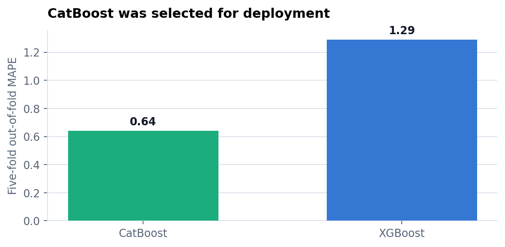
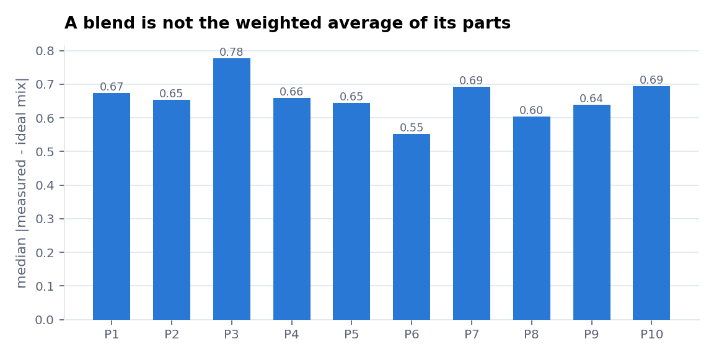
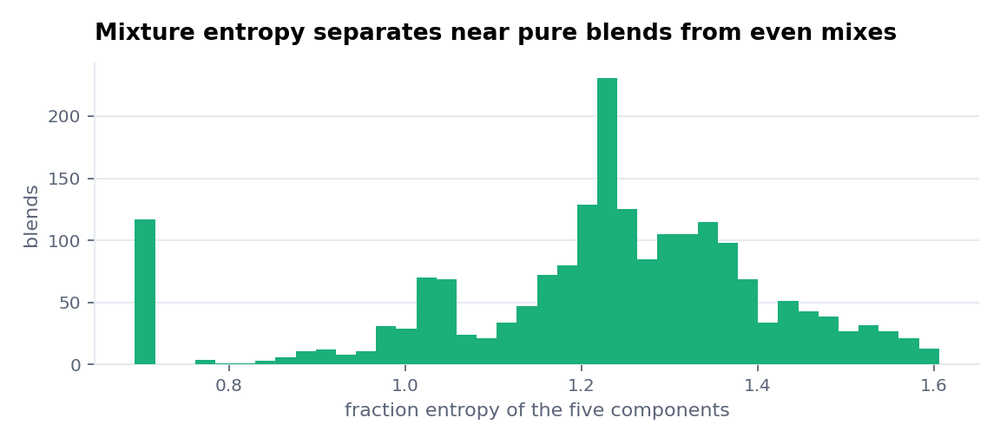

# End-to-End Multi-Output Fuel Blending System

This project predicts ten properties of a fuel blend from the fractions and
measured properties of its five components. It covers feature engineering,
five-fold model selection, saved preprocessing artifacts, and a containerized
FastAPI service that returns predictions as a CSV.

I built it independently for the Shell.ai Hackathon 2025 and deployed the
inference service on AWS EC2.

## Result

CatBoost reached an out-of-fold mean absolute percentage error of 0.64,
compared with 1.29 for XGBoost under the same five-fold split. The training
pipeline therefore refits CatBoost on all 2,000 training blends and saves it
for inference.

<picture>
  <source media="(prefers-color-scheme: dark)" srcset="docs/model-comparison-dark.png">
  
</picture>

The comparison is made on out-of-fold predictions rather than the training
rows. The selected model is refitted only after both candidates have been
evaluated.

## Why the weighted average is not enough

A linear blend would have properties equal to the fraction-weighted average of
its components. Across the training set, the median absolute gap between that
ideal mixture and the measured blend ranges from about 0.55 to 0.78 for the ten
targets.

<picture>
  <source media="(prefers-color-scheme: dark)" srcset="docs/blend-deviation-dark.png">
  
</picture>

That gap is the nonlinear behaviour the model has to learn.

## Feature engineering

`src/engineer.py` derives the same features during training and serving.

| Feature | Meaning |
|---|---|
| `W_P{j}_C{i}` | This is component `i`'s fraction-weighted contribution to property `j`. |
| `Ideal_P{j}` | This is the linear weighted-average baseline for property `j`. |
| `Spread_P{j}` | This is the range between the largest and smallest weighted contributions. |
| `Entropy` | This measures how evenly the five component fractions are distributed. |
| `Max_Frac` and `Is_Pure` | These identify blends dominated by one component. |

Entropy distinguishes a near-pure blend from an even five-component mixture,
even when their weighted averages are similar.

<picture>
  <source media="(prefers-color-scheme: dark)" srcset="docs/mixture-entropy-dark.png">
  
</picture>

## Training and inference stay aligned

`train_model.py` performs the following steps:

1. It constructs the engineered feature matrix.
2. It replaces infinite values and fills missing values with training medians.
3. It scales all ten targets with one fitted `StandardScaler`.
4. It evaluates CatBoost and XGBoost through `MultiOutputRegressor` on the same
   shuffled five-fold split.
5. It refits the better model on the complete training set.
6. It saves the model, target scaler, and training medians together.

The API reloads those saved artifacts. It does not calculate replacement
statistics from an uploaded batch, so a row is transformed the same way in
training and inference.

## API

`app.py` exposes one endpoint:

```text
POST /predict    multipart file=<blends.csv>    ->    text/csv
```

The response contains `BlendProperty1` through `BlendProperty10`. If the upload
contains an `ID` column, the response preserves it. If it does not, the service
adds a zero-based `ID` so every prediction still has a stable row identifier.

The Docker image uses Python 3.11 and runs Uvicorn on port 80.

## Run locally

Install the dependencies and train the model:

```bash
pip install -r requirements.txt
python train_model.py
```

Training writes these files:

```text
models/model.pkl
models/scaler.pkl
models/medians.pkl
```

Start the service and send a CSV:

```bash
uvicorn app:app --port 8000 --reload
curl -F "file=@data/test.csv" http://localhost:8000/predict -o predictions.csv
```

The Postman collection in `Shell AI.postman_collection.json` sends the same
request.

## Run with Docker

```bash
docker build -t fuel-blending .
docker run -p 8000:80 fuel-blending
```

The endpoint is then available at `http://localhost:8000/predict`.

## Repository layout

| Path | Purpose |
|---|---|
| `src/engineer.py` | This module builds the features shared by training and inference. |
| `train_model.py` | This script compares the two regressors, refits the winner, and saves its artifacts. |
| `app.py` | This module serves CSV predictions through FastAPI. |
| `eda.ipynb` | This notebook explores the component and blend distributions. |
| `data/` | This directory contains the competition train and test sets. |
| `models/` | This directory contains the fitted model, target scaler, and training medians. |

The original competition page is available on
[HackerEarth](https://www.hackerearth.com/challenges/new/competitive/shellai-hackathon-2025/).
